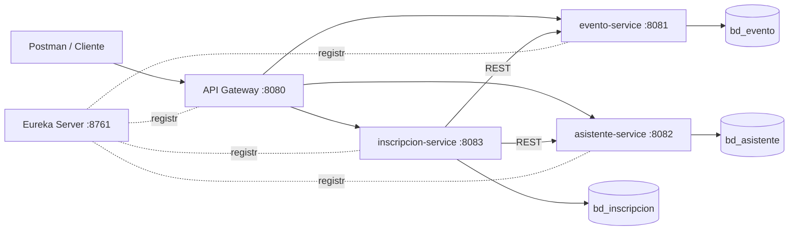

# Diagrama de microservicios y bases de datos



```
Postman -> Gateway:8080 -> evento:8081      -> bd_evento
                        -> asistente:8082   -> bd_asistente
                        -> inscripcion:8083 -> bd_inscripcion
                              |-- REST --> evento / asistente (valida existencia, estado y cupo)
Todos se registran en Eureka:8761
```
Tablas: `evento(id, nombre, lugar, fecha, capacidad, estado)`, `asistente(id, nombre, apellido, email UNIQUE, telefono)`, `inscripcion(id, id_evento, id_asistente, fecha, estado)` — sin FK física entre BDs; la integridad se valida por REST.
